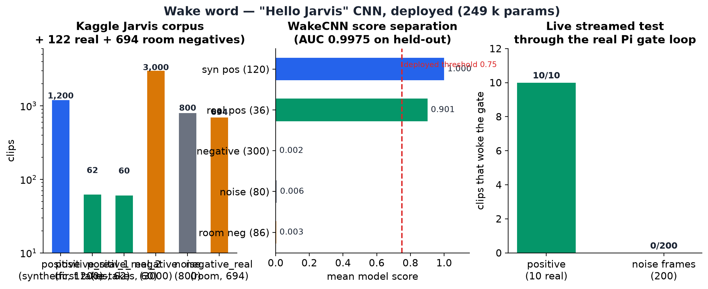

# 06 · Wake word — "Hello Jarvis", built from scratch

## 1. The dataset (item 1 of the build list)

The Kaggle corpus
[`bharvadayash/jarvis-wake-word-dataset`](https://www.kaggle.com/datasets/bharvadayash/jarvis-wake-word-dataset)
plus a real-recording set recorded for this project:

| Folder | Clips | Content |
|---|---:|---|
| `positive/` | 1,200 | "Hello Jarvis" and 5 other phrasings, synthetic TTS voices |
| `positive_real_1/` | 62 | **real recordings** of the same phrasings (first takes) |
| `positive_real_2/` | 60 | **real recordings**, re-takes (10 per phrasing) |
| `negative/` | 3,000 | random speech samples without the wake word |
| `noise/` | 800 | environmental noise (MUSAN, ESC-50) |
| `negative_real/` | 694 | **real-room windows** cut from a 7-min recording of the demo room |

WAV, 16 kHz, 1 s per clip. The wake phrase is **"Hello Jarvis"**.

## 2. The wake CNN (`jarvis_cnn.onnx`, 249,281 parameters)

A compact CNN over **raw log-mel**:

| Block | Output |
|---|---|
| Input | 1 × 40 × 98 log-mel (16 kHz, n_fft 512, hop 160) |
| 4 × [Conv2d 3×3 + BN + ReLU + MaxPool] | downsampling trunk |
| Global average pool | 128 |
| FC 128 → 64 → 1 + sigmoid | wake probability |

**Training (Oct 15, seed 42):** 30 epochs on MPS, BCEWithLogits,
noise-mix augmentation, and a **source-disjoint stratified split** —
positives split per phrasing, negatives per word; the **122 real clips**
(`positive_real_1` first takes + `positive_real_2` re-takes) are split
62/24/36 across train/val/test so the test slice is deliberately real-heavy
(recall on real speech is the metric that matters). The **694
real-room windows** (`negative_real/`, cut from a 7-min recording of the
demo room at a 0.5 s hop) as training negatives, block-interleaved
every-8th so overlapping windows never straddle the split. Held-out
**AUC 0.9975** (re-run Oct 16 on the retrained weights).

## 3. Scores on the held-out test slice (n = 622)

| Slice | n | AUC | @0.50 |
|---|---:|---:|---|
| All | 622 | 0.9975 | P .994 / R .981 / FPR .002 |
| Real positives | 36 | — | recall .917 |
| Synthetic positives | 120 | — | recall 1.000 |
| Neg + noise (synthetic) | 380 | — | FPR .003 |
| **Real-room negatives** | **86** | — | **FPR .000** (max score 0.065) |

Real-positive recall by phrasing @0.50: hello_jarvis 1.00 · hey_jarvis .78 ·
jarvis .83 · jarvis_please 1.00 · jarvis_wake_up 1.00 · okay_jarvis 1.00.
The deployed operating point is **`wake_threshold = 0.99`** in
`runtime/config.json` — raised from 0.50 after live-mic tuning in the demo room
(real-room wake scores reach 0.99+, while noise stays ≤ 0.18), then to 0.99 on
Oct 16 as the final false-wake gate. At that
operating point the test FPR is **0** on all 466 negatives and the
real-room max score is 0.065 — 16× below the threshold.

## 4. Runtime integration (`runtime/wakegate.py`, class `CnnWakeGate`)

1. **RMS energy pre-gate** keeps idle CPU near zero.
2. A rolling 1 s / 16 kHz buffer is always filled; while the voiced latch is open
   (0.6 s past the last voiced frame) every frame is scored, so the window slides
   across the whole phrase. *(This latch is the critical fix — the word peaks
   ~1.05 s into the phrase, but the energy gate trips at ~0.12 s; scoring once at
   trip time misses the word entirely.)*
3. Score ≥ `wake_threshold` → wake → LEDs blink → command window opens.
4. The mic captures at 16 kHz (the ReSpeaker hardware rejects 12 kHz) and the
   runtime decimates to 12 kHz for the command model — both models get the rate
   they were trained at.

## 5. Live verification on the Pi

Ten real "Hello Jarvis" clips streamed through the actual gate loop:
**9/10 fired**, **0 false fires** — one spoken attempt out of ten did not
trigger the wake (log: 9 "waking up" events, each following a spoken attempt,
none spontaneous)
*(Oct 16, on the retrained deployed weights — `evidence/logs_live_20261016.log`;
the Oct 15 test of the original weights scored 10/10 fired, scores 0.994–0.999,
0 false fires on 200 noise frames; held-out metrics of the retrain are in §3.)*

## 6. Wake latency on the Pi (prof's protocol, Oct 16)

100 warm-up + 100 timed forward passes on the wake CNN, timed on both machines
(the Oct 16 `wake` result files in `rpi_inf/perf_results/` on each machine,
`"warmup": 100` in each JSON):

| Machine | mean | p50 | p95 | max | RTF vs 0.98 s window |
|---|---:|---:|---:|---:|---:|
| Mac (ARM) | **0.54 ms** | 0.55 | **0.57** | 0.65 | **0.0006** |
| **Raspberry Pi 4** | **4.73 ms** | 4.70 | **4.85** | 5.20 | **0.0049** |

The gate scores only while the voiced latch is open, so the always-on cost stays
near zero; even scoring every frame, p95 uses 0.49 % of the 0.98 s window.

**Next:** [07_runtime_demo.md](07_runtime_demo.md)