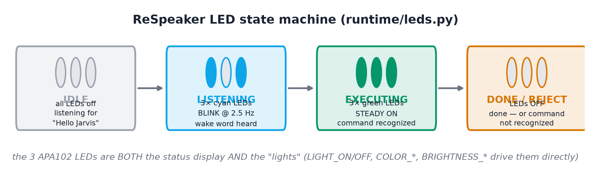

# 07 · Runtime & demo — the 8 items on real hardware


!(figures/fig_coverage.png)

## 1. LED status language (item 2)

The ReSpeaker 2-Mics HAT carries 3 APA102 RGB LEDs (SPI). The state model:

| State | LEDs | Meaning |
|---|---|---|
| **IDLE** | all off | listening for "Hello Jarvis" |
| **LISTENING** | **cyan, blinking** @ 2.5 Hz | wake word heard — say your command |
| **EXECUTING** | **green, steady on** | command recognized — running it now |
| **DONE / REJECT** | off | finished — or command not recognized |

Implementation: `runtime/leds.py` auto-detects the installed `apa102` package
variant and bit-bangs GPIO14/15 when `/dev/spidev` is absent; every method degrades
to a no-op without the HAT so the voice pipeline never dies because of the LEDs.

**Hardware rule:** the ReSpeaker's LEDs *are* the lights — no Tapo bulb, no
smart-home cloud account, no Wi-Fi configuration beyond the Pi's normal network
connection. The only devices are the ReSpeaker HAT and a USB speaker.

## 2. Command → action map (all 37 fine labels)

| Fine labels | Action backend | Answer |
|---|---|---|
| `PLAY_MUSIC` `PAUSE` `STOP` `NEXT` | mp3 playlist via mpv JSON-IPC (ffplay fallback) | the music itself |
| `VOLUME_UP` `VOLUME_DOWN` | mpv volume ±10 % per command | the music itself |
| `LIGHT_ON` `LIGHT_OFF` | **ReSpeaker LEDs** on/off (`runtime/leds.py`) | the LEDs themselves |
| `BRIGHTNESS_20/60/100` | ReSpeaker LED brightness (APA102 0–31 scale → 6/19/31) | the LEDs themselves |
| `COLOR_RED/BLUE/GREEN/YELLOW` | ReSpeaker LED colour (RGB presets) | the LEDs themselves |
| `TIMER_10s/30s/1m` | **per-slot chime MP3** (`audio/timer/TIMER_10s.mp3` etc.), played exactly like a music track | the chime itself |
| `WEATHER` | **Open-Meteo (keyless)** — default Quezon City (14.6357, 121.0325) | spoken: real conditions |
| `TIME` | the Pi's own clock, `datetime.now()` | spoken: "It's 3:15 pm." |
| `ALARM_6_00AM/8_00AM/9_00PM` | simulated — no device | spoken: "Alarm set for 6:00 am." |
| `TEMPERATURE_18/22/26` | simulated — no thermostat | spoken: "Setting the temperature to 22 degrees." |
| `CREATE_REMINDER_*` `LIST_REMINDERS` | in-memory reminder store | spoken: confirmation / the list |
| `CALL` `MESSAGE` | simulated — no radio | spoken confirmation |
| `OUT_OF_SCOPE` | rejected | spoken: "Sorry, I can't do that." |

Every command except music/lights/timer answers with a **spoken sentence** played
by `runtime/tts.py` — a pre-recorded MP3 (the `en_GB-alan-medium` "Jarvis" voice,
synthesized offline by `rpi_inf/gen_responses.py`). ALARM, TEMPERATURE,
CREATE_REMINDER, LIST_REMINDERS, CALL and MESSAGE speak a simulated confirmation —
There is no web dashboard, so there is no UI to display them on.

## 3. The main loop (`runtime/vcm.py`)

```
mic (16 kHz) ──▶ RMS pre-gate ──▶ wake CNN (0.99) ──▶ LED blink
             ──▶ 1 s window ──▶ log-mel ──▶ CRNN ──▶ min_conf 0.25
             ──▶ dispatch ──▶ action ──▶ LED steady ──▶ off ──▶ spoken answer
```

* An asyncio loop runs in a background thread; dispatch posts coroutines to it via
  `run_coroutine_threadsafe`.
* TTS runs in its own worker thread with a one-slot queue (`say()` is
  non-blocking, so the voice loop never stalls); a beep path (`TonePlayer`) covers
  cue/ack sounds.
* `--dry-run` runs the full loop but stubs the music player (used only for
  development; never part of the submission folder).

## 4. What a demo looks like

1. Say **"Hello Jarvis"** → LEDs blink cyan.
2. Say **"lights on"** → LEDs go steady green → the three LEDs turn on → off.
3. Say **"lights blue"** / **"brightness 60"** → the LEDs change colour/brightness.
4. Say **"play music"** → track 1 starts; **"next"** skips; **"volume up"** raises it.
5. Say **"what time is it"** → the Pi answers in the Jarvis voice.
6. Say **"what's the weather"** → Open-Meteo is queried; the Pi speaks the conditions.
7. Say **"set a timer for 10 seconds"** → the timer chime MP3 plays when it fires.

**Next:** [08_rpi_setup.md](08_rpi_setup.md)